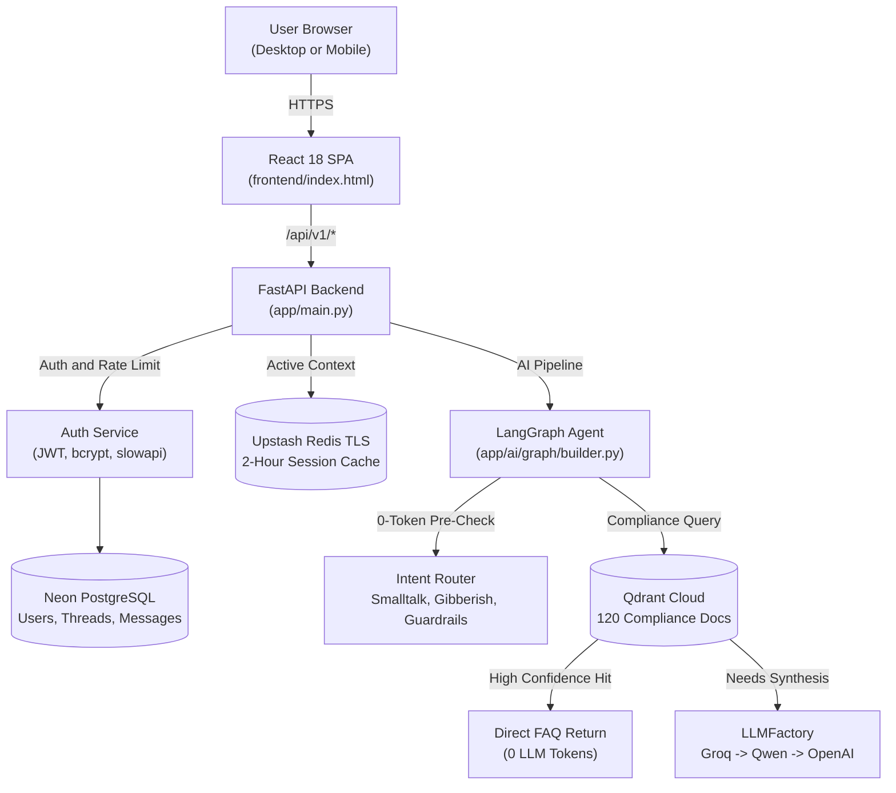
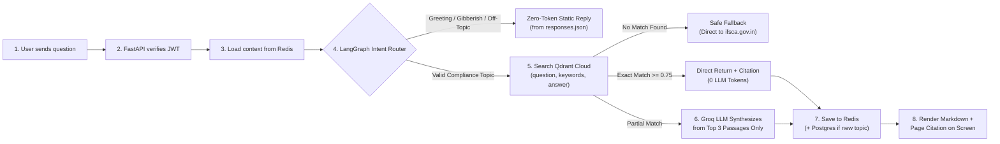

# ComplyADI — GIFT City IFSC Compliance Assistant

**ComplyADI** is a full-stack regulatory FAQ assistant built for compliance officers, startup founders, and finance teams operating in **GIFT City IFSC (Gujarat, India)**. Instead of searching through long regulatory PDFs manually, users can ask plain-English compliance questions and get clear, source-cited answers with page numbers.

**Live App:** [https://student-web-app-test.vercel.app](https://student-web-app-test.vercel.app)  
*(Use the **1-Click Examiner Demo Login** button on the sign-in page for instant testing.)*

---

## Key Features

- **Vectorless Full-Text RAG (Qdrant):** Searches curated compliance FAQs (`25` core topics) and parsed regulatory PDFs (`DoingBusinessatIFSC.pdf`, `DirectListingFramework.pdf` — `120` indexed chunks) using fast `MatchText` keyword filtering without slow embedding models.
- **Exact Source & Page Citations:** Every regulatory answer displays a source card showing the official circular/document name and exact page badge (`Page X`).
- **Zero-Token Safety Guardrails:** Greetings, smalltalk, gibberish/keyboard smashes, prompt-injection attempts, and off-topic queries (coding, sports, etc.) are filtered locally before calling any AI model.
- **3-Tier LLM Fallback Chain:** Uses **Groq (`openai/gpt-oss-120b`)** as primary, automatically falls back to **Groq (`qwen/qwen-2.5-32b`)**, and uses **OpenAI (`gpt-4o-mini`)** as an emergency backup.
- **Smart Memory (Redis + PostgreSQL):** **Upstash Redis** holds active session context (2-hour TTL) so follow-up questions stay fast without cluttering **Neon PostgreSQL**, which stores users and distinct conversation threads permanently.
- **Safe "I Don't Know" Fallback:** Never hallucinates missing laws—if a question is outside the compliance database, it directs users to `https://ifsca.gov.in` or an IFSCA-registered expert.
- **Production Hardening:** JWT authentication (`bcrypt` + `PyJWT`), IP rate limiting (`slowapi`), Alembic DB migrations, GZip compression, request timing logs, DOMPurify XSS sanitization, and real-time service diagnostics.

---

## System Architecture



---

## How a Chat Request Flows



---

## Tech Stack

| Layer | Technology | Purpose |
|---|---|---|
| **Frontend** | React 18, HTML5, CSS3, Marked, DOMPurify | Responsive UI, hash routing, sanitized Markdown & citations |
| **Backend** | Python, FastAPI, Uvicorn, Pydantic | Async REST API, validation, middleware, static serving |
| **AI Orchestration** | LangGraph, LangChain | Deterministic routing, zero-token guardrails, fallback chains |
| **LLM Providers** | Groq (`gpt-oss-120b`, `qwen-2.5-32b`), OpenAI | Fast regulatory answer synthesis with multi-tier backup |
| **Knowledge Search** | Qdrant Cloud (Vectorless) | Full-text payload indexing across FAQs and parsed PDFs |
| **Database** | Neon Serverless PostgreSQL + SQLAlchemy + Alembic | Persistent users, chat threads, and schema migrations |
| **Hot Cache** | Upstash Cloud Redis (TLS) | Short-term session memory and smart follow-up detection |
| **Hosting** | Vercel (Serverless FastAPI) | Live HTTPS deployment with automatic GitHub sync |

---

## Project Folder Structure

```text
.
├── alembic/                    # Database migration scripts (PostgreSQL)
├── app/
│   ├── ai/
│   │   ├── graph/              # LangGraph state, nodes, and routing builder
│   │   └── prompts/            # Dynamic compliance_system.txt & responses.json
│   ├── chatbot/                # Chat & health check API router
│   ├── config/                 # Settings (.env loader), async DB pool, Redis pool
│   ├── data/                   # compliance_faqs.json (25 curated seed FAQs)
│   ├── exceptions/             # Custom errors and global FastAPI handlers
│   ├── middlewares/            # JWT Bearer dependency & guest fallback
│   ├── models/                 # SQLAlchemy ORM models (User, Conversation, Message)
│   ├── providers/              # LLMFactory (Groq/OpenAI) & Qdrant client
│   ├── routes/                 # Auth routes (/auth/*) & PDF ingest routes (/ingest/*)
│   ├── schemas/                # Pydantic request & response schemas
│   ├── services/               # Auth, Chat smart persistence, Redis, Qdrant/PDF ingest
│   ├── utils/                  # Guardrails, gibberish check, rate limiter, logger
│   ├── main.py                 # FastAPI app setup, CORS, GZip, request logging
│   └── server.py               # Local Uvicorn runner
├── frontend/
│   ├── src/
│   │   ├── api/                # Modular API clients (http, authApi, chatApi, ingestApi)
│   │   ├── components/         # Sidebar, MessageBubble, ChatInput
│   │   ├── pages/              # AuthPage & ChatPage
│   │   └── utils/              # Safe Markdown + DOMPurify renderer
│   ├── styles/                 # Responsive CSS (desktop & mobile)
│   └── index.html              # App entry point
├── .env.example                # Safe environment template
├── docker-compose.yml          # Optional local Postgres, Redis, and Qdrant containers
├── justfile                    # Quick commands (just backend, just frontend)
├── pyproject.toml              # Project metadata & dependencies
└── requirements.txt            # Locked Python dependencies
```

---

## Quick Local Setup

### 1. Clone and Install Dependencies
```bash
git clone https://github.com/nakul-cloud/Student-Web-App-Test.git
cd Student-Web-App-Test

# Using uv (recommended) or standard venv + pip
python -m venv .venv
.venv\Scripts\activate        # On Windows
pip install -r requirements.txt
```

### 2. Configure Environment Variables
Copy `.env.example` to `.env` and fill in your database, Redis, Qdrant, and Groq keys:
```bash
cp .env.example .env
```

*(Optional)* If running databases locally instead of cloud services, start them with Docker:
```bash
docker compose up -d
```

### 3. Run Database Migrations
```bash
alembic upgrade head
```

### 4. Start the App
```bash
python -m app.server
```
Open **`http://localhost:8000`** in your browser (it automatically redirects to `/frontend/index.html#/login`).

---

## API Overview

| Method | Endpoint | Description |
|---|---|---|
| `GET` | `/api/v1/chatbot/health` | Real-time status check for PostgreSQL, Redis, and Qdrant |
| `POST` | `/api/v1/auth/register` | Create a new user account (rate-limited) |
| `POST` | `/api/v1/auth/login` | Authenticate user and receive JWT token (rate-limited) |
| `POST` | `/api/v1/auth/demo-login` | 1-click evaluator sign-in |
| `POST` | `/api/v1/chatbot/chat` | Send compliance question through LangGraph pipeline |
| `GET` | `/api/v1/chatbot/sessions` | List saved conversations for the signed-in user |
| `GET` | `/api/v1/chatbot/sessions/{id}/messages` | Load full message history for a conversation |
| `POST` | `/api/v1/ingest/pdf-file` | Upload and index a PDF document page-by-page into Qdrant |
| `POST` | `/api/v1/ingest/pdf-url` | Fetch and index a remote regulatory PDF from URL |

Interactive API documentation is available at `/docs` when `ENV=development`.
